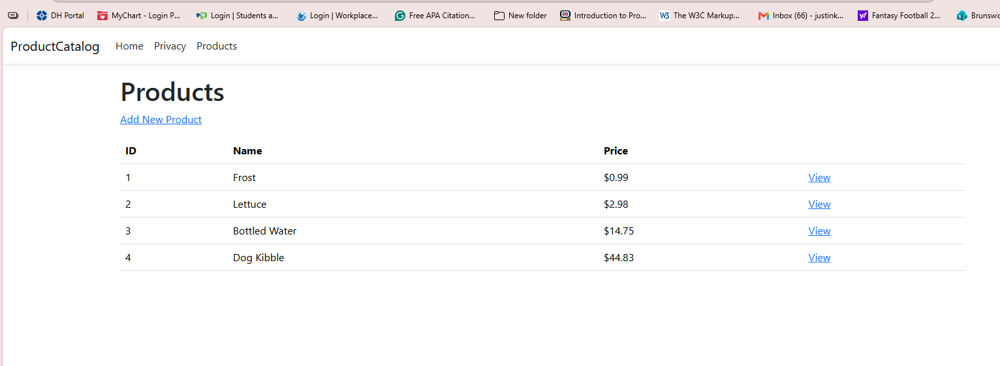
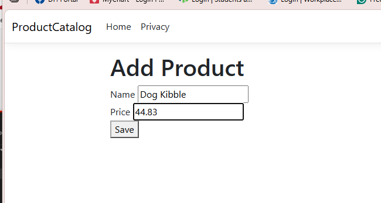

# ProductCatalog

An ASP.NET Core MVC app for viewing and adding products. Products are saved to a JSON file.

## Features

- **Index** – lists all products
- **Details** – shows one product
- **Create** – adds a new product with validation:
  - Name is required
  - Price must be between 0.01 and 1000
- **JSON persistence** – products are stored in `data/products.json`
- **Navigation** – added a Products link to the navbar in `_Layout.cshtml`, next to the Home and Privacy links

## How to Run

```
cd ProductCatalog
dotnet run
```

Then go to `/Products` in the browser.

## Screenshots

### Index Page


### Create Page
